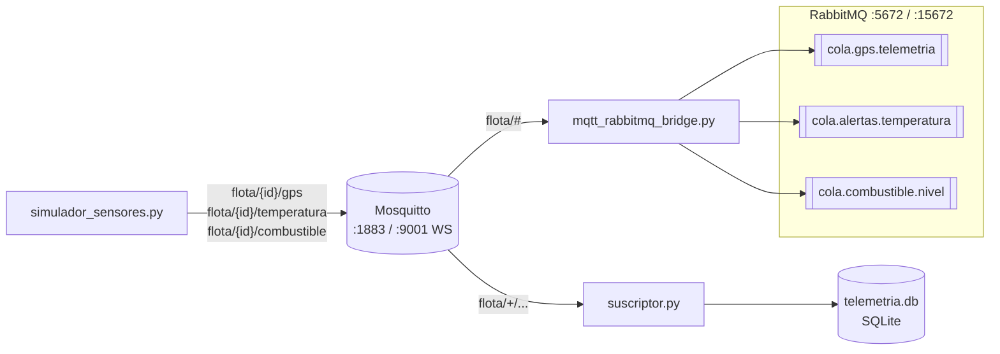

# APE-5 — Sistemas Distribuidos

**Práctica 5: Mensajería distribuida con MQTT y RabbitMQ**

Sistema de monitoreo de una flota de vehículos refrigerados. Sensores simulados
publican telemetría por MQTT; un suscriptor la almacena en SQLite y genera
alertas, y un puente reenvía los datos relevantes a colas de RabbitMQ para que
otros servicios los consuman de forma asíncrona.

## Arquitectura



| Componente | Archivo | Función |
|---|---|---|
| Brokers | `practica5/docker-compose.yml` | Mosquitto 2.0 (MQTT 1883, WebSocket 9001) y RabbitMQ 3 con panel de administración |
| Simulador | `practica5/simulador_sensores.py` | Publica GPS, temperatura y combustible de 3 vehículos cada 5 s |
| Suscriptor | `practica5/suscriptor.py` | Guarda la telemetría en SQLite y muestra alertas por consola |
| Puente | `practica5/mqtt_rabbitmq_bridge.py` | Reenvía GPS y alertas desde MQTT a colas durables de RabbitMQ |

### Reglas de negocio

| Sensor | Condición | Acción del suscriptor | Cola en RabbitMQ |
|---|---|---|---|
| GPS | Siempre | Guarda en `gps_data` | `cola.gps.telemetria` |
| Temperatura | > 4 °C | Guarda en `temp_data` y alerta | `cola.alertas.temperatura` (`type: TEMP_ALERT`) |
| Combustible | < 20 % | Guarda en `fuel_data` y alerta | `cola.combustible.nivel` (`type: FUEL_LOW`) |

## Requisitos

- Docker con Docker Compose
- Python 3.10 o superior
- Puertos libres: `1883`, `9001`, `5672` y `15672`

## Ejecución

```bash
# 1. Entrar al proyecto y preparar el entorno virtual
cd practica5
python -m venv .venv
source .venv/bin/activate          # Windows: .venv\Scripts\activate
pip install -r requirements.txt

# 2. Levantar los brokers
docker compose up -d
```

Luego, en **tres terminales** distintas (con el entorno virtual activado):

```bash
python suscriptor.py              # Terminal 1: almacena y alerta
python mqtt_rabbitmq_bridge.py    # Terminal 2: reenvía a RabbitMQ
python simulador_sensores.py      # Terminal 3: genera la telemetría
```

Cada script se detiene con `Ctrl+C`. Para apagar los brokers:

```bash
docker compose down
```

### Verificación

- **MQTT:** `docker exec -it mosquitto_broker mosquitto_sub -t 'flota/#' -v`
- **SQLite:**
  ```bash
  python -c "import sqlite3; c=sqlite3.connect('telemetria.db'); [print(r) for r in c.execute('SELECT * FROM temp_data ORDER BY id DESC LIMIT 5')]"
  ```
- **RabbitMQ:** abrir <http://localhost:15672> (usuario `guest`, clave `guest`) y revisar la pestaña *Queues and Streams*.

> Si al levantar los contenedores aparece `Bind for 0.0.0.0:5672 failed: port is already allocated`,
> otro RabbitMQ está usando ese puerto. Detenlo (`docker stop <contenedor>`) y vuelve a ejecutar
> `docker compose up -d --force-recreate rabbitmq`.

## Capturas

### Actividad 1 — Mosquitto en Docker

Contenedores activos y configuración con el listener WebSocket en el puerto 9001:


Prueba de publicación y suscripción dentro del broker:


Topics jerárquicos de los 3 vehículos recibidos por un suscriptor MQTT (`flota/#`):


### Actividad 2 — Simulador de sensores


### Actividad 3 — Suscriptor y SQLite

Alertas por consola cuando la temperatura supera 4 °C:


Alertas de temperatura (> 4 °C) y de combustible bajo (< 20 %) en la consola del suscriptor:


Últimas filas almacenadas en cada tabla:


### Actividad 4 — Puente MQTT → RabbitMQ

Puente reenviando GPS y alertas `TEMP_ALERT` / `FUEL_LOW`:


Colas durables (`D`) con mensajes en el panel de RabbitMQ:


## Decisiones de diseño

- **Suscripción en `on_connect`:** si el cliente pierde la conexión con Mosquitto y se
  reconecta, las suscripciones se renuevan automáticamente; suscribirse una sola vez
  después de `connect()` las perdería.
- **Colas durables y mensajes persistentes (`delivery_mode=2`):** las colas y los
  mensajes sobreviven a un reinicio de RabbitMQ, así no se pierden alertas.
- **Heartbeats de pika:** `BlockingConnection` no es thread-safe, así que los callbacks de
  paho (que corren en otro hilo) solo encolan los mensajes en una `queue.Queue`. El hilo
  principal es el único que usa pika: publica lo pendiente y llama a
  `process_data_events()` en cada vuelta, lo que responde los heartbeats aunque no lleguen
  alertas y evita que RabbitMQ cierre la conexión por inactividad.
- **Consultas parametrizadas (`?`)** en SQLite para evitar inyección SQL, y manejo de JSON
  inválido o incompleto sin detener el suscriptor.

## Preguntas de control

**1. ¿Diferencias clave entre MQTT y AMQP? ¿Por qué MQTT es más adecuado para IoT?**

| | MQTT | AMQP (RabbitMQ) |
|---|---|---|
| Protocolo | Binario muy ligero, cabecera mínima de 2 bytes, sobre TCP | Más completo y pesado: canales, transacciones, confirmaciones, propiedades por mensaje |
| Patrón | Publicación/suscripción por topics a través de un broker | Colas con enrutamiento flexible (directo, fanout, topic, headers), punto a punto y pub/sub |
| Casos típicos | Sensores, dispositivos con poca batería, CPU o ancho de banda; redes inestables | Integración entre servicios backend, colas de trabajo, procesamiento confiable de tareas |

MQTT es más adecuado para IoT porque consume poco ancho de banda y energía, tolera
conexiones intermitentes (keepalive, sesiones persistentes, *last will*) y los dispositivos
solo necesitan conocer el broker y el topic. En esta práctica se combinan los dos: MQTT
recoge la telemetría de los vehículos y AMQP distribuye a los servicios internos solo lo
que requiere procesamiento.

**2. ¿Por qué MQTT usa jerarquías de topics y RabbitMQ usa exchanges, colas y bindings? ¿Ventajas de cada enfoque?**

- **Topics jerárquicos (MQTT):** el enrutamiento está implícito en el nombre
  (`flota/VH-001/temperatura`) y los suscriptores filtran con comodines (`+` un nivel,
  `#` varios niveles). Es simple, no requiere configuración previa y escala bien con miles
  de dispositivos. Su limitación es que el broker no almacena mensajes para consumidores
  ausentes salvo sesiones persistentes o mensajes *retained*.
- **Exchanges, colas y bindings (RabbitMQ):** separa quién publica (exchange) de dónde se
  guarda (cola) y cómo se conectan (binding). Permite reglas de enrutamiento complejas,
  repartir trabajo entre varios consumidores, persistir mensajes y confirmar su
  procesamiento (*ack*). A cambio, exige declarar y configurar esa topología.

En el proyecto, los topics de MQTT agrupan la telemetría por vehículo y sensor, y el puente
la traduce a colas durables específicas por tipo de alerta.

**3. Niveles de QoS en MQTT: ventajas, desventajas y uso en el monitoreo de flota**

| QoS | Garantía | Ventajas | Desventajas | Uso en la flota |
|---|---|---|---|---|
| 0 — *at most once* | Se envía una vez, sin confirmación | Máximo rendimiento, mínimo tráfico | Puede perderse | GPS: se publica cada pocos segundos y una lectura perdida se reemplaza con la siguiente |
| 1 — *at least once* | Se reenvía hasta recibir `PUBACK` | Garantiza la entrega con poco costo extra | Puede llegar duplicado | Temperatura y combustible: una alerta no debe perderse y un duplicado es inofensivo |
| 2 — *exactly once* | Handshake de 4 pasos (`PUBREC`/`PUBREL`/`PUBCOMP`) | Ni pérdidas ni duplicados | Mayor latencia y tráfico | Eventos que no se pueden repetir, como una orden remota de bloqueo del vehículo o un registro de facturación |

En la implementación actual el simulador publica con QoS 0 (valor por defecto) y el
suscriptor y el puente se suscriben con QoS 1; como el QoS efectivo es el menor de ambos,
para garantizar las alertas habría que publicar temperatura y combustible con `qos=1`.

## Estructura

```
practica5/
├── Capturas/                  # Evidencias de cada actividad
├── mosquitto/config/
│   └── mosquitto.conf         # Listeners 1883 (MQTT) y 9001 (WebSocket)
├── docker-compose.yml         # Mosquitto + RabbitMQ
├── simulador_sensores.py
├── suscriptor.py
├── mqtt_rabbitmq_bridge.py
├── requirements.txt           # paho-mqtt 2.x, pika
└── README.md
```
